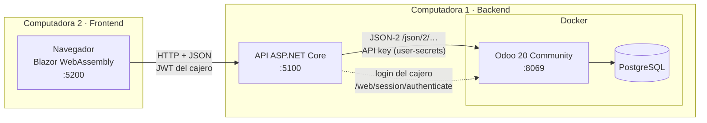
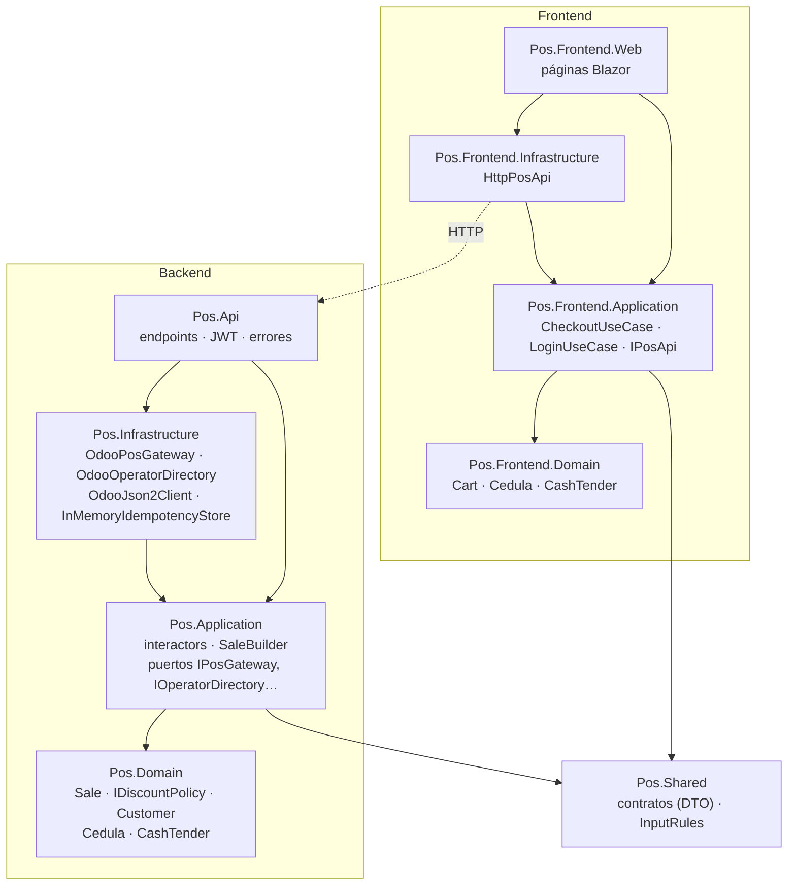
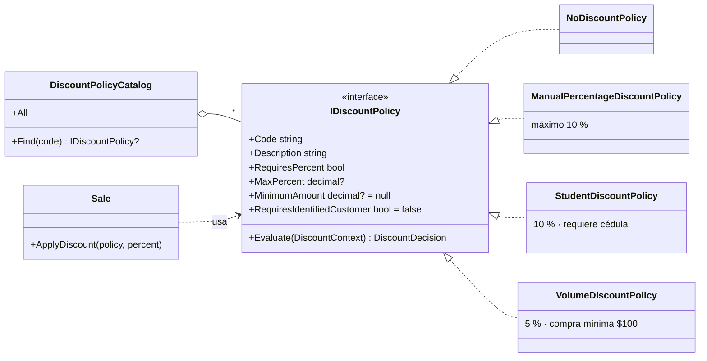
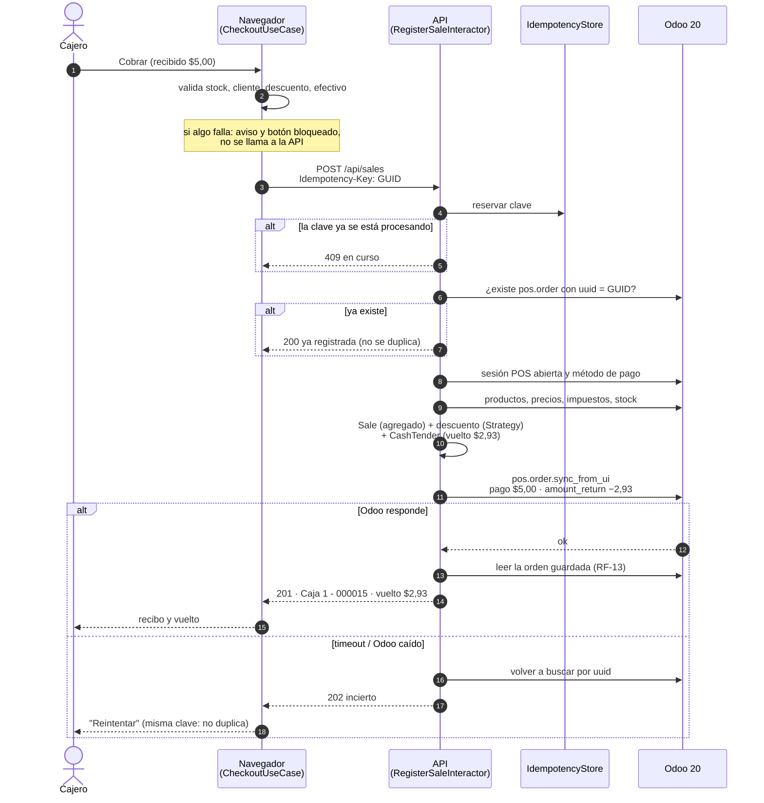
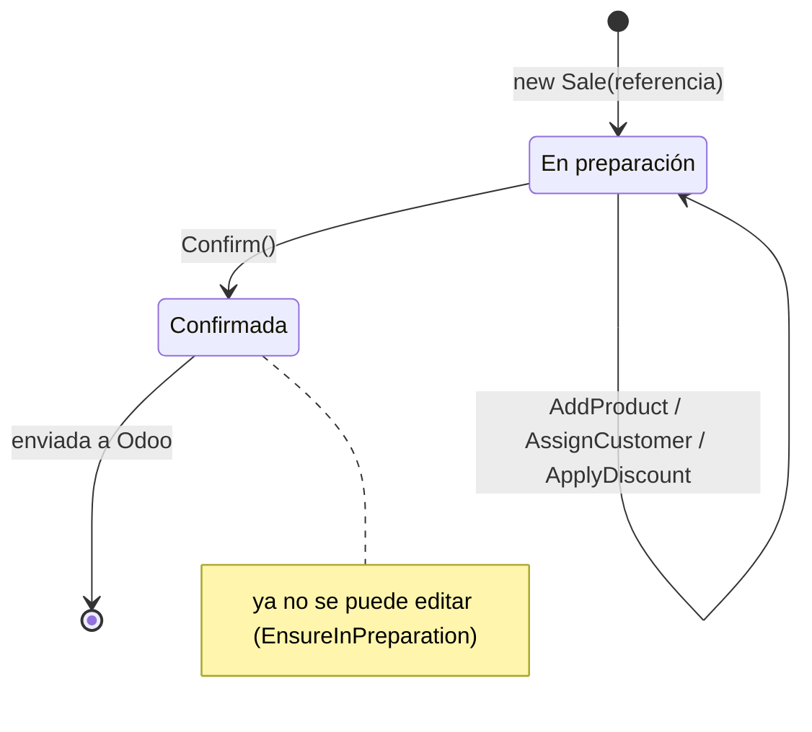

# Diagramas

Los diagramas están en [Mermaid](https://mermaid.js.org/): GitHub y VS Code (extensión
*Markdown Preview Mermaid Support*) los dibujan solos. Para la exposición se pueden exportar
a imagen en <https://mermaid.live> (pegar el bloque y descargar PNG/SVG).

## 1. Despliegue (presentación con dos computadoras)

- El navegador **nunca** habla con Odoo ni conoce la API key (RNF-09).
- La API **nunca** toca PostgreSQL de Odoo: todo pasa por la API de Odoo.

## 2. Capas (Clean Architecture)

Las flechas son referencias entre proyectos: siempre apuntan hacia el dominio.

`ArchitectureTests` comprueba que `Pos.Domain` no depende de nada y que `Pos.Application`
no conoce Infrastructure ni ASP.NET.

## 3. Strategy: políticas de descuento (D1)

Agregar un descuento = una clase nueva y una línea en `DependencyContainer`. Sus condiciones
(`MinimumAmount`, `RequiresIdentifiedCustomer`) viajan en `GET /api/discount-policies` y la
pantalla las valida sin cambios.

## 4. Secuencia del cobro (RF-11, RF-16/17, RN-07)

## 5. Estados de la venta (D4)

